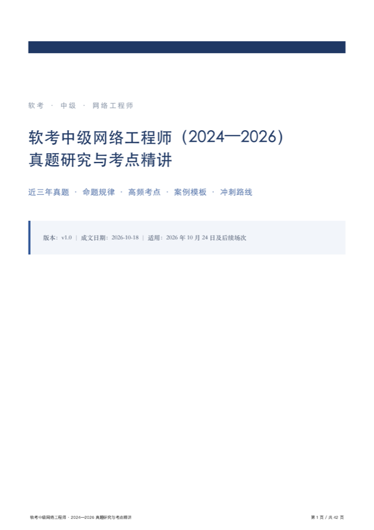

# 软考中级网络工程师 · 近三年真题研究与考点精讲

> 把“考生回忆版真题”当作可校对的一手材料：逐题复核、标注出处与争议，并做成**能一键重建**的 PDF / Word / Markdown 三件套。

一份面向 2024—2026 年软考中级**网络工程师**的备考资料与研究笔记。不是题库搬运，而是一次「把信息来源分层、把结论标可信度」的整理实践。

---

## 为什么做这个项目

市面上的网工资料有两个通病：

1. **把回忆版当原卷**。软考官方从不公开真题，所有“真题”都来自考生回忆与机构整理，题干措辞、选项顺序、甚至数字都可能错，但很少有人标注这一点。
2. **考情靠二手转述**。考试日期、题量、时长、合格线被反复转载，越传越偏——例如流传甚广的“2025 年网络工程师只考一次”，与两省官方考务通知直接矛盾。

所以本项目做了三件事：

- **制度性信息查官方**：日期、科目、题型、时长、合格标准，逐条对照工信部教考中心文件与各省人事考试机构转发的考务通知。
- **题目标来源、标争议**：每道题注明场次，答案统一称“参考答案”，对有争议的题单独开框说明（如 2025 下 IPv6 Next Header）。
- **全文可重建、可 diff**：内容以 Markdown 分片维护，`make build` 一条命令重新生成三种格式，改一个字也能看出改了哪里。

## 内容速览

| 章节 | 内容 | 约页数 |
|---|---|---|
| 摘要与阅读指南 | 数据来源与可靠性分级、三类读者的使用路径 | 3 |
| 第 1 章 考试制度与近三年考情 | 两科题型、机考改革、2024—2026 六个场次、报名到领证 | 3 |
| 第 2 章 命题规律与难度画像 | 75 题的知识板块分布、4 道大题骨架、三条命题主线、10 条陷阱清单 | 3 |
| 第 3 章 高频考点精讲 | 十个知识域的结构化表 + 必背口径 + 易错点 | 11 |
| 第 4 章 真题选析 | **27 道真题**，逐题给答案、解析、考点、易错点 | 8 |
| 第 5 章 案例题精讲 | 四步答题框架 + 华为 VRP 配置模板 + 2 道模拟案例 | 6 |
| 第 6 章 备考路线 | 三阶段路线、考前 6 天冲刺表、240 分钟时间分配 | 2 |
| 附录 A—F | 端口表、默认值表、VRP 命令速查、计算公式、术语对照、参考资料 | 4 |

## 考情速览（2024—2026）

| 场次 | 考试日期 | 形式 |
|---|---|---|
| 2024 年上半年 | 5 月下旬 | 机考 |
| 2024 年下半年 | 11 月上旬 | 机考 |
| 2025 年上半年 | 5 月 24—27 日 | 机考 |
| 2025 年下半年 | 11 月 8—11 日 | 机考 |
| 2026 年上半年 | 5 月 23—26 日 | 机考 |
| 2026 年下半年 | 10 月 24—27 日 | 机考 |

三条容易被误导的事实：

- **网络工程师近三年每半年都开考**，没有“停考”或“一年只考一次”。
- **2023 年下半年起全面机考**，两科连考共 240 分钟，第一科最短 90、最长 120 分钟。
- **两科同次均 ≥45 分**才算通过，单科成绩不保留。

## 快速开始

### 方式一：直接下载

| 格式 | 文件 | 说明 |
|---|---|---|
| PDF | [软考中级网络工程师_2024-2026真题研究与考点精讲.pdf](dist/软考中级网络工程师_2024-2026真题研究与考点精讲.pdf) | 42 页，含页脚页码与带页码目录 |
| Word | [.docx](dist/软考中级网络工程师_2024-2026真题研究与考点精讲.docx) | 标题层级、表格、代码块可编辑 |
| Markdown | [.md](dist/软考中级网络工程师_2024-2026真题研究与考点精讲.md) | 纯文本源，便于二次编辑 |

> Word 版的目录**故意不带页码**：PDF 的页码是按浏览器排版算出来的，Word 重新分页后会错位。用导航窗格跳转更可靠。

### 方式二：本地重建

~~~bash
git clone https://github.com/GUIDchen/ruankao-network-engineer.git
cd ruankao-network-engineer
make build        # 需要 1—2 分钟：两遍排版 + 页码回填
make check        # 校验 PDF 页数/纸张、DOCX 包结构
~~~

### 依赖

| 组件 | 用途 | 说明 |
|---|---|---|
| Python 3.9+ | 全部构建脚本 | 只用标准库，无第三方包 |
| Node.js 22+ | 通过 CDP 打印 PDF（页脚页码） | 缺失时自动回退到 Chrome 命令行 |
| Google Chrome | 排版与打印 | 需支持 `--headless=new` |
| poppler | `pdftotext` / `pdfinfo` | 目录页码回填与产物自检 |
| 中文字体 | 宋体/黑体渲染 | macOS 自带 Songti SC、Heiti SC；Linux 建议装 Noto CJK |

macOS 一键装依赖：

~~~bash
brew install node poppler
~~~

## 目录结构

~~~
.
├── src/                    # 分片书写的正文（作者侧源文件）
│   ├── part1.md            # 封面、摘要、第 1—2 章
│   ├── part2.md            # 第 3 章 高频考点
│   ├── part3.md            # 第 4 章 真题选析
│   └── part4.md            # 第 5—6 章与附录
├── tools/
│   ├── assemble.py         # 合并分片、修复代码块与选项排版
│   ├── toc.py              # 生成/回填目录
│   ├── pages.py            # 从 PDF 中提取每个标题所在页码
│   ├── build.py            # Markdown → HTML → PDF，同时手写 OOXML 生成 DOCX
│   ├── pdf.mjs             # 用 Chrome DevTools Protocol 打印带页脚的 PDF
│   ├── check.py            # 产物自检（页数、纸张、XML、目录）
│   ├── fixcode.py          # 对齐代码块中的注释列
│   └── style.css           # 打印样式（A4、页边距、表格、代码块）
├── dist/                   # 生成物：.pdf / .docx / .md
├── assets/                 # README 用图
└── Makefile
~~~

## 构建流程

~~~text
src/part*.md
   │  assemble.py      合并、占位符还原、代码块补全、选项换行
   ▼
dist/….md  ──toc.py──▶  目录（先不带页码）
   │  build.py         Markdown → HTML → Chrome 打印 PDF
   │                   同一份 AST 直接写出 DOCX（手写 OOXML）
   ▼
PDF ──pages.py──▶ 标题→页码映射 ──toc.py --map──▶ 目录回填页码
   │
   └─ build.py 再跑一遍（页码入目录后版面不变，故两遍即收敛）
~~~

几个设计取舍，写在 README 里备查：

- **自己写 OOXML**：构建环境装不上 `python-docx`（pip 源不可达），索性按 OOXML 规范直接生成 `document.xml` + `styles.xml`，反而拿到了对标题层级、表格列宽、页脚页码的完全控制。
- **用 CDP 而不是命令行打印**：`chrome --print-to-pdf` 无法加页脚，改用 DevTools Protocol 的 `Page.printToPDF` 才拿到“第 N 页 / 共 M 页”。
- **两遍排版**：目录页码会改变分页，先排版取页码、回填后再排版，最后比对两次页码是否漂移。
- **表格列宽按内容权重分配**：纯 auto 布局在 CJK 下会把短列压成单字换行。

## 校对与勘误

欢迎提 Issue，尤其是这几类：

- **题干有误**：贴出场次、题号、你认为正确的表述。
- **答案存疑**：请给出教材页或配置手册依据，而不是“我觉得”。
- **考情更新**：以官方考务通知链接为准。

已知的、已在文中标注的局限：

| 项目 | 现状 |
|---|---|
| 2024 年考试日期 | 仅精确到旬（官方通知未逐省核对），表中已注明 |
| 真题来源 | 考生回忆版，非原卷；题干细节可能与原卷有出入 |
| IPv6 Next Header 题 | B、C 各对一半，标准答案取 C，文中单列“争议题提醒” |
| 页数 | 随内容修订变化，README 中的 42 页为 v1.0 数值 |

## 数据来源

制度性信息核对自以下公开文件（访问日期 2026-10-18）：

- [2026 年度考试工作安排及山西考区通知](http://gxt.shanxi.gov.cn/xwdt/tzgg/202603/t20260318_10082303.shtml)（计考办〔2026〕1 号）
- [2025 年上半年考务通知 · 青海](http://qhpta.org.cn/ncms/article_a6e2aa9af68f2e95813c8391c6f88240.shtml)
- [2025 年上半年考务通知 · 山东](http://hrss.shandong.gov.cn/rsks/articles/ch03527/202503/704867af-0518-4408-8ae0-2b561bc60a02.shtml)
- [2025 年下半年网络工程师考试安排](https://m.cnitpm.com/pm1/173623ahdssesry2.html)（信管网）
- [2026 年下半年分值占比与时间分配](https://www.hqwx.com/web_news/html/2026-10/17921224885496.html)（环球网校）

真题题干来自希赛、环球网校、CSDN 等平台整理的考生回忆版，具体链接见文档附录 F。

## 免责声明

- 本项目与工业和信息化部教育与考试中心、中国计算机技术职业资格网**无任何隶属或合作关系**。
- 真题题干来自公开的考生回忆版，版权归原命题方；本项目仅作学习研究之用，如涉侵权请联系删除。
- 答案与解析为编者复核结果，**可能存在争议**，不构成考试承诺。
- 考试政策随时可能调整，一切以官方最新通知与准考证为准。

## 许可

- **代码**（`tools/`、`Makefile`）：[MIT](LICENSE)
- **文档内容**（`src/`、`dist/`）：[CC BY-NC-SA 4.0](https://creativecommons.org/licenses/by-nc-sa/4.0/deed.zh) —— 署名、非商业性使用、相同方式共享

转载或二次整理请保留来源与免责声明。

## Roadmap

- [ ] 补充 2026 年下半年真题（10 月 24 日考后）
- [ ] GitHub Actions 自动构建（Chrome + Noto CJK 镜像）
- [ ] 把 27 道真题做成可自测的折叠问答
- [ ] 生成手机友好的单页 HTML

## English

A reproducible study guide for China's **Software Proficiency Exam — Intermediate Network Engineer** (软考中级网络工程师), covering the 2024–2026 sessions. It separates official exam policies (dates, format, scoring) from candidate-recalled past papers, flags contested answers, and ships as PDF / DOCX / Markdown that rebuild from a single `make build`. Code is MIT-licensed; the study material is CC BY-NC-SA 4.0.
